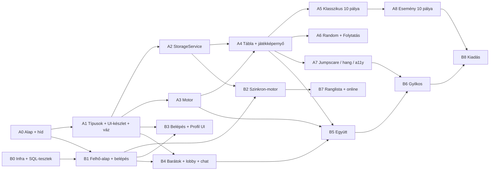

# NIGHTDOKU — a munka felosztása két AI között

> Verzió: 1 · Dátum: 2026-10-25 · A termék igazsága: [NIGHTDOKU_jatekterv.md](../NIGHTDOKU_jatekterv.md) (GDD v0.3)

## 1. Elv

A projektet **rétegek mentén** vágtuk ketté, nem funkciók mentén — így a két AI a nap nagy részében *nem ugyanazokat a fájlokat* szerkeszti, és nem vár egymásra.

| | **AI-A — „A játék"** | **AI-B — „A felhő, a társas módok és a kiadás"** |
|---|---|---|
| **Felelős** | amit a játékos *játszik*: motor, tábla, mentés a gépen, minden egyjátékos mód, hang/jumpscare, a pályák tartalma | amit a játékos *megoszt és szinkronizál*: fiók, profil, felhős mentés, barátok, chat, co-op módok, adatbázis, weboldal, kiadás |
| **Módok** | Klasszikus (10) · Esemény (10) · Random | Együtt · Gyilkos |
| **GDD-fejezetek** | 5–15, 19.1–19.4, 20 | 16.2, 17.5, 18, 19.5–19.7, 22–24 |
| **Fő nyelv/eszköz** | Electron, React, TypeScript, kézi tartalom-szerkesztés | TypeScript, SQL (Postgres/RLS), Supabase Realtime, Vercel, CI |

**Hogyan nem akadnak egymásba:** a két oldal csak a [CONTRACTS.md](CONTRACTS.md)-ben rögzített **szerződéseken** keresztül beszél. AI-A sosem hív Supabase-t (csak a `CloudService` interfészt, amihez van üres `NullCloud`), AI-B sosem olvas közvetlenül a `memory` mappába (csak a `StorageService`-en át). Ezért **mindkettő önállóan fejleszthető és tesztelhető**, és az összeillesztés a *kapuknál* (5. fejezet) történik.

## 2. Ki mit visz (feature-térkép)

| Terület | Tulajdonos | GDD |
|---|---|---|
| Electron-ablak, preload-híd, `memory` mappa helye, single-instance | **A** | 16.5, 17.1, 17.4 |
| Szabálymotor, megoldó (egyértelműség), seedelt generátor | **A** | 5.2, 19.2, 19.3, 20 |
| Tábla, játékképernyő, eszköztár, tippek, bemutató | **A** | 2.4, 14.3–14.5 |
| Helyi mentés (`StorageService`, JSON-fájlok, `.bak`, méretkeret) | **A** | 17.1–17.4 |
| Klasszikus mód (10 pálya + 2 bónusz + kampány-panelek) | **A** | 5, 6, 8, 9 |
| Esemény mód (10 pálya, világ-szabályok, gyűjtemény) | **A** | 10, 11 |
| Random mód felület (Folytatás-lista, ügykód, napi ügy kliens-oldala) | **A** | 14.8, 19.1–19.6 |
| Jumpscare, hang, zene, beállítások, akadálymentesség | **A** | 12, 13, 14.x |
| Felület-készlet (design tokenek, komponensek), app-váz, útvonalak | **A** | 14 |
| Supabase-kliens, belépés/regisztráció, profil-szolgáltatás | **B** | 18.2, 18.3 |
| Szinkron-motor (sor, összefésülés, idempotens feltöltés), katalógus-frissítés | **B** | 17.5, 18 |
| Belépés / Profil / Fiók képernyők | **B** | 14.6, 14.7, 18.5 |
| Barátok, profil-keresés, meghívás, lobby, szoba-szolgáltatás, chat | **B** | 14.9, 14.10, 23 |
| Co-op „Együtt": Realtime-protokoll, közös tábla-szinkron, újracsatlakozás, overlay | **B** | 22.1, 22.2, 14.11 |
| Co-op „Gyilkos": szerepek, képességek, Gyűlés/Szimat/Epilógus, `0003` migráció | **B** | 22.3–22.5 |
| Ranglista, online-állapot, nyilvános profil-kártya, moderáció | **B** | 19.6, 23.1, 23.2 |
| Supabase-séma, migrációk, SQL-tesztek | **B** | 18.4 |
| Weboldal (`web/`), Vercel, keep-alive, kiadás (GitHub Releases), CI-kiadás | **B** | 24 |

## 3. Útvonal-tulajdonlás (ide ír, aki a tulajdonos; máshova nem)

| Útvonal | Tulajdonos | Megjegyzés |
|---|---|---|
| `electron/**` | A | `main.ts`, `preload.ts`, a híd (CONTRACTS 5.) |
| `src/app/**`, `src/ui/**`, `src/i18n/**` | A | app-váz, útvonal-tábla, UI-készlet, szövegek |
| `src/engine/**`, `src/components/**` | A | motor és a tábla-komponensek |
| `src/storage/**` | A | a `StorageService` implementációja |
| `src/screens/{menu,classic,event,random,game,collection,settings}/**` | A | |
| `puzzles/**`, `assets/**` | A | pálya-JSON-ok, portrék, hangok |
| `package.json`, `vite.config.*`, `tsconfig*`, `eslint*`, `electron-builder*`, `.github/workflows/ci.yml` | A | **B csak függőséget adhat hozzá** külön `chore(deps):` commitban, előtte `git pull --rebase` |
| `src/cloud/**`, `src/coop/**` | B | a `CloudService` implementációja, szoba-kliens |
| `src/screens/{login,profile,friends,lobby,coop}/**` | B | A az indulásnál csak üres csonkot hoz létre (A1) |
| `supabase/**` | B | migrációk + SQL-tesztek |
| `web/**`, `.github/workflows/release.yml` | B | Vercel-projekt, kiadás |
| `src/shared/**`, `docs/CONTRACTS.md` | **közös** | csak a 7. fejezet szerint |
| `docs/tasks/A.md` · `docs/handoff/A.md` | **A** | csak A szerkeszti: a saját feladat-táblája és kimenő üzenetei (outbox) |
| `docs/tasks/B.md` · `docs/handoff/B.md` | **B** | csak B szerkeszti: a saját feladat-táblája és kimenő üzenetei (outbox) |
| `docs/TASKS.md` · `docs/HANDOFF.md` · `docs/handoff/PLANNER.md` | a felhasználó / a tervező | az AI-k csak olvassák; a kapuk lezárását a saját outboxukban írják alá |
| `.work/**`, `.dev-userdata/**`, `memory*/` | — | gitignore-olt, nem verziózott (munkakönyvtárak, fejlesztői adatok) |
| `NIGHTDOKU_jatekterv.md` | közös | csak a *saját* fejezeteidet (2. fejezet) frissítsd; szerkezeti/scope változás = `DECISION` a felhasználónak |
| `AGENTS.md`, `CLAUDE.md`, `docs/AI_SPLIT.md`, `docs/briefs/**` | a felhasználó / a tervező | ne írd át, javaslatot tegyél a HANDOFF-ban |

## 4. Függőségek és sorrend



**Mi indulhat azonnal, a másikra várás nélkül:**
- **A:** A0 (alap és híd) — ez az *egyetlen* dolog, amire B várhat (a `secure` tároló miatt), ezért **A0-t kell elsőnek befejezni**.
- **B:** B0 (infra), B1 előkészítés tiszta TypeScript-modulokként (szinkron-összefésülés, protokoll-reducer, mindez egység-tesztelve, a `CONTRACTS.md` típusaira építve), amíg A0 elkészül.

## 5. Mérföldkövek („kapuk") — itt illesztjük össze, ami addig külön élt

| Kapu | Mikor | Ellenőrzés (mindkét AI aláírja a saját outboxában) |
|---|---|---|
| **G0 — Alap** | A0 + A1 + B0 kész | `npm run dev` natív ablakot nyit · `window.nightdoku.secure` működik · CI zöld · a `src/shared/` típusok bent vannak |
| **G1 — Első játszható + belépés** | A4 + A5 (min. 3 pálya) + B1 + B2 + B3 kész | regisztráció → belépés → Klasszikus #1 megoldása → az eredmény a `progress.json`-ban **és** a Supabase `runs`/`progress` táblában · offline is játszható · másik gépen/mappában látszik a haladás |
| **G2 — Folytatás** | A6 + B2 kész | Random ügy félbehagyása az egyik gépen → folytatás a másikon (`saves` szinkron) · kilépés közbeni mentés nem veszít |
| **G3 — Együtt** | B4 + B5 kész | két példány (`NIGHTDOKU.exe --memory=./memory-b`) belép egy szobába, közös tábla, a másik lerakását el lehet vinni, chat, újracsatlakozás 2 percen belül |
| **G4 — Gyilkos** | B6 + A7 kész | 3 példány · a szerep **nem szivárog** a hálózati forgalomból · 3 képesség hűtéssel, értesítés nélkül · Gyűlés, Szimat, Epilógus · döntetlen/győzelem helyesen kerül a `runs`-ba |
| **G5 — 1.0** | A8 + B7 + B8 kész | mind a 10+10 pálya · ranglista · kiadási build a GitHub Releases-en · letöltőoldal |

Minden kapunál **az integrátor** az, aki a *fogyasztó* oldalon van (G1: A, mert A hívja a CloudService-t; G3/G4: B, mert B tolja a BoardController-t), de a **kapu lezárása közös**: mindketten aláírják a saját outboxukban (`G1 — aláírom`).

## 6. Munkafolyamat

**Munkakönyvtár — mindkét AI külön `git worktree`-ben dolgozik, a felhasználónak semmit nem kell klónoznia.** Egy közös mappában a két AI egymás nem mentett fájljait, a git-indexet, a `node_modules`-t, a build-kimenetet és a fejlesztői szerver portját is összekeverné; egy worktree-nek viszont saját munkafája, indexe és ága van, miközben ugyanazt a `.git`-et használják.

```bash
bash scripts/ai-setup.sh A      # AI-A  ->  .work/A  (ág: ai-a)
bash scripts/ai-setup.sh B      # AI-B  ->  .work/B  (ág: ai-b)
```
- A szkript **idempotens**, és a `.env`-et átmásolja (gitignore-olt). A munkakönyvtár a projektmappán **belül** van (`.work/`, gitignore-olt), így az AI-eszközök külön engedély nélkül írhatnak bele.
- Az alap a helyi `main`, ha az előrébb jár az `origin/main`-nél (még nem pusholt commitok); különben az `origin/main`.
- A `node_modules` worktree-nként külön van (`npm install` a saját mappában). A fő mappa (`D:\Projectss\HorrorDoku`) a felhasználó / tervező saját példánya — **az AI-k oda nem írnak.**
- **Fejlesztői példányok ne ütközzenek** (A0 követelménye): dev módban az Electron `userData` a munkakönyvtárban van (`.dev-userdata/`), ezért az A és B egyszerre futó fejlesztői példányai nem tiltják ki egymást a single-instance zárral; a Vite-szerver portja szabadon választott (`strictPort: false`); az e2e-tesztek nem használnak fix portot; a lint/teszt/typecheck-glob kizárja a `.work/` és `memory*/` mappákat.

**Ágak és szinkron.** Szigorú útvonal-tulajdonlás mellett az ütközés ritka, ezért **trunk-based**: a saját munkád a saját ágadon (`ai-a` / `ai-b`) készül, kis, tesztelt commitokban, és a `main`-re így kerül fel:
```bash
bash scripts/ai-sync.sh pull      # a saját ágad rebase-elése az origin/main-re (a nem commitolt munkád megmarad)
bash scripts/ai-sync.sh push      # fetch -> rebase -> push a main-re; force NÉLKÜL; ha közben a másik AI pusholt, újrapróbál
```
- A `push` csak **tiszta munkafával** és **zöld teszt után** (te futtatod előtte) megy; **soha ne `--force`**, és ne használd a `git push`-t közvetlenül a `main`-re.
- **Rebase-ütközés:** ha csak a *saját* fájljaid ütköznek, oldd fel, `git add`, `git rebase --continue`, majd `push`. Ha a *másik AI* fájljaival ütköznél: `git rebase --abort`, és írj az outboxodba — ez a tulajdonjogi határok miatt nem fordulhatna elő.
- **Közös / szerződés-érintő** változás (`docs/CONTRACTS.md`, `src/shared/**`, gyökér-konfig): lásd a 7. fejezetet — előbb javaslat az outboxban, a másik nyugtája, utána a módosítás.
- A `HANDOFF` ebben a leírásban mindig az **outboxodat** jelenti (`docs/handoff/A.md` vagy `B.md`; szabályok: [HANDOFF.md](HANDOFF.md)).

**Session-kezdés** (mindig): `bash scripts/ai-setup.sh <A|B>` (ha még nincs munkakönyvtár) → `bash scripts/ai-sync.sh pull` → a *másik AI* outboxa és a `docs/handoff/PLANNER.md` (neked szóló, még nem megválaszolt üzenetek) → a saját feladat-táblád **és a másikét** (a függőségek miatt) → válaszd a következő olyan feladatot, amelynek minden függősége ✅ → jelöld 🟨-ra és `push` (hogy a másik lássa).

**Session-vége** (mindig): tesztek → commit → a saját feladat-táblád frissítése (állapot, commit-hash) → ha kell valami a másiktól vagy kész valami, amire vár: bejegyzés az outboxodba → `bash scripts/ai-sync.sh push`.

**Ellenőrzés egymásnak.** Ha a feladatod egy szerződést *fogyaszt*, olvasd el a másik oldali megvalósítást és írd a HANDOFF-ba, ha eltér a CONTRACTS.md-től. Ez a *kereszt-review*.

**Vitás kérdés** → HANDOFF `DECISION (felhasználó)` bejegyzés; amíg nincs döntés, a szerződés szerinti, kisebb kockázatú irányt vidd tovább.

## 7. Szerződés-módosítás

1. **Javaslat az outboxodban:** `REQUEST` a másik AI-nak — a *pontos* változtatás (a módosított típus-blokk), az indoklás és a *hatása a másik oldalra*. Még **nem** írod át a `CONTRACTS.md`-t.
2. A másik AI nyugtáz (`RE: <ID> — DONE`) vagy ellenvetést ír (`RE: <ID> — ELLENVETÉS`).
3. Nyugta után **te** módosítod a `docs/CONTRACTS.md`-t és a `src/shared/**` megfelelő fájlját egy külön commitban (`feat(contract): …`), a `CONTRACT_VERSION`-t **emeled**, ha törő a változás, és `push`.
4. **Kivétel:** kizárólag *bővítő*, visszafelé kompatibilis változást (új opcionális mező, új típus) nyugta nélkül is felviheted — de ugyanabban a pillanatban írj róla `INFO`-t az outboxodba.
5. A fogyasztó oldal a push után frissít; törő változásnál a javaslattevő segít átállni.

## 8. Tesztelési minimum

| Szint | Eszköz | Ki felelős |
|---|---|---|
| Egység-tesztek (motor, összefésülés, reducer, tároló) | `vitest` | mindenki a sajátjára |
| Generátor-tulajdonságok: 1000 seedre érvényes + pontosan 1 megoldás | `vitest` | A |
| SQL: RLS, trigger, függvények | `cd supabase/tests && npm test` (PGlite) | B |
| Böngészős füstteszt (játék, felület) | `puppeteer-core` + Brave | A (játék), B (belépés/profil/lobby) |
| Több példányos co-op teszt | 2–3 példány, külön `--memory` mappával | B |

## 9. Kérdések a felhasználónak (nyitottak)

1. **Ki merge-el, ha az AI-k nem tudják?** (Jelenleg trunk-based, push a `main`-re; ha ez nem megfelelő, kapcsold be a branch protection-t és PR-okra váltunk.)
2. **Repó láthatósága:** publikus — a pálya-JSON-ok megoldásokat tartalmaznak (spoiler). Javaslat: a `puzzles/` mappa kerüljön *privát* repóba / a Supabase `puzzles` táblájába, vagy a teljes repó legyen privát.
3. **Portrék és pálya-illusztrációk forrása** (kb. 40–80 karakter): saját rajz, AI-képgenerálás, vagy jogtiszta készlet? Ez a Random-készlet bővülési ütemét szabja.
4. **Idegen franchise-ok nevei** a nyilvános kiadásban: a GDD 21. fejezete paródia-nevekre javasol átállni. Mikor döntsünk?
5. **Vercel Hobby** nem kereskedelmi használatra való — ha a játék bevételt hoz, Pro kell.
6. **Nyelvek:** első kiadás csak magyar? (az i18n-váz kész lesz angolra is).
